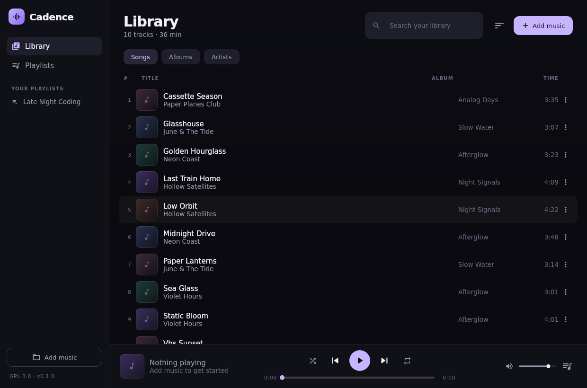
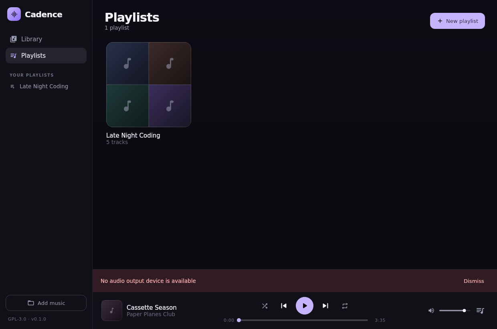

# Cadence

A free, open-source music player for **desktop and Android**, built from one
Kotlin Multiplatform + Compose Multiplatform codebase.

Cadence plays music that is already on your device, and can also search and
stream from **YouTube Music** (with optional sign-in sync and offline saves).
No ads, no telemetry; the local player works fully offline.



## Features

- **One codebase, two platforms** — Android app and a native desktop app
  (Windows, macOS, Linux) from the same Compose Multiplatform UI.
- **Local library** — import a folder on desktop, or read the on-device
  MediaStore library on Android.
- **Metadata & artwork** — ID3/Vorbis/FLAC tags and embedded cover art, with
  folder-based `cover.jpg`/`folder.png` fallbacks.
- **Library views** — songs, albums and artists, with search and sorting by
  title, artist, album, recently added or duration.
- **Playlists** — create, rename, delete, add and remove tracks.
- **Player** — play/pause, previous/next, seek, volume, shuffle and
  repeat off/all/one.
- **Queue** — play next, add to queue, jump to any track.
- **Persistence** — library and playlists survive restarts.
- **Keyboard shortcuts** on desktop: `Space` toggles playback, `←`/`→` seek
  back/forward 5 seconds.
- **YouTube Music** — search songs, stream them, and optionally sign in to sync
  liked songs and saved playlists.
- **SponsorBlock** — automatically skip sponsors, self-promos, interaction
  reminders, intros, outros, previews, filler and non-music segments, with
  per-category toggles (fetched from `sponsor.ajay.app`, fails open).
- **Offline saves** — download online tracks for offline playback, with progress,
  cancel, storage usage and one-tap clearing.
- **Dark, responsive UI** — a sidebar layout on desktop and a bottom-nav layout
  on phones.

## Screenshots

| Library | Playlists |
| --- | --- |
|  |  |

## Getting started

### Requirements

- JDK 17
- Android SDK (platform 35, build-tools 35.0.0) for the Android target
- Linux, macOS or Windows

The Gradle wrapper is committed, so no separate Gradle install is needed.

### Build and run the desktop app

```bash
./gradlew :composeApp:run
```

On Linux, if the machine has no GPU/OpenGL support (for example inside a
container), force software rendering:

```bash
SKIKO_RENDER_API=SOFTWARE ./gradlew :composeApp:run
```

### Package the desktop app

```bash
# Linux .deb
./gradlew :composeApp:packageDeb

# Windows .msi / .exe (run on Windows with JDK 17; MSI requires WiX Toolset)
./gradlew :composeApp:packageMsi
./gradlew :composeApp:packageExe

# macOS .dmg (run on macOS)
./gradlew :composeApp:packageDmg
```

Installers are written to `composeApp/build/compose/binaries/`. Release
packages for Linux, Windows, and macOS are also built automatically by the
`Build desktop packages` GitHub Actions workflow (`.github/workflows/build-release.yml`).

### Build the Android app

```bash
export ANDROID_HOME=/path/to/android-sdk
./gradlew :composeApp:assembleDebug     # debug APK
./gradlew :composeApp:assembleRelease   # minified release APK (unsigned)
```

Artifacts:

- Debug: `composeApp/build/outputs/apk/debug/composeApp-debug.apk`
- Release (R8 minified + resources shrunk): `composeApp/build/outputs/apk/release/composeApp-release-unsigned.apk`

Install with:

```bash
adb install composeApp/build/outputs/apk/release/composeApp-release-unsigned.apk
```

`local.properties` may also be used to point at the SDK:

```properties
sdk.dir=/path/to/android-sdk
```

## Using Cadence

1. **Add music** — on desktop, choose a folder; on Android, grant audio access.
   Cadence scans recursively and reads tags and cover art.
2. **Browse** — switch between Songs, Albums and Artists. Use the search field
   and sort menu to narrow things down.
3. **Play** — click a track, or press play on an album/artist page. Shuffle and
   repeat live in the player bar.
4. **Build playlists** — open a track's `⋮` menu and choose *New playlist…* or
   add it to an existing one. Playlists appear in the sidebar.

## Architecture

```
composeApp/src/
├── commonMain/          # shared Compose UI, models, queue and persistence
│   └── kotlin/app/cadence/
│       ├── model/       # Track, Playlist
│       ├── data/        # LibraryRepository (library + playlists)
│       ├── player/      # AudioEngine contract, PlayerController (queue/shuffle/repeat)
│       ├── platform/    # expect declarations for platform services
│       ├── ui/          # screens, player bar, now playing, queue, theme
│       └── util/        # formatting helpers
├── desktopMain/         # Java Sound engine, folder scanning, JAudioTagger, JSON files
└── androidMain/         # ExoPlayer, MediaStore, permissions, SharedPreferences
```

The shared layer owns everything user-facing. `PlayerController` implements the
queue, shuffle bag and repeat modes on top of a small `AudioEngine` interface;
each platform only supplies file access, metadata, artwork and a single-track
playback engine.

### Playback backends

| Platform | Engine | Formats |
| --- | --- | --- |
| Desktop | FFmpeg (optional) or Java Sound + soundlibs SPI | With FFmpeg: any codec FFmpeg supports (incl. AAC/M4A, Opus/WebM). Without: MP3, FLAC, OGG, WAV |
| Android | AndroidX Media3 ExoPlayer | Whatever the device codecs support (MP3, AAC/M4A, FLAC, OGG, Opus, WAV) |

Desktop decoding prefers **FFmpeg** when available, which covers the AAC/M4A and
Opus/WebM streams YouTube serves. It is detected on `PATH`, via
`-Dcadence.ffmpeg=/path/to/ffmpeg`, or in common install locations. Without FFmpeg
the engine falls back to Java Sound (MP3/FLAC/OGG/WAV). If the audio device does
not expose the file's native sample rate, the engine resamples to 44.1 kHz or
48 kHz automatically.

### Data storage

- **Desktop:** JSON files in `$XDG_DATA_HOME/Cadence` (or
  `~/.local/share/Cadence`); artwork is cached in `Cadence/artwork/`.
- **Android:** JSON documents in `SharedPreferences`; artwork is cached in the
  app cache directory.

Nothing is uploaded anywhere.

## Status & roadmap

Cadence is at **v0.1.0**, an early but usable release.

- [x] Local library import and metadata
- [x] Songs / albums / artists views, search, sorting
- [x] Playlists
- [x] Queue, shuffle, repeat, seek, volume
- [x] Desktop and Android packaging
- [x] YouTube Music search and streaming (Android and desktop)
- [x] YouTube Music sign-in (Android WebView) and liked/playlist sync
- [x] Offline downloads with progress, cancel and storage management
- [x] SponsorBlock segment skipping with configurable categories
- [ ] Android background playback with media notifications
- [ ] MPRIS / media key integration on desktop
- [ ] Drag-and-drop files onto the desktop window
- [ ] Waveform/visualizer and crossfade
- [ ] MPRIS / media key integration on desktop
- [ ] Automated tests and CI builds

### YouTube Music notes

YouTube/InnerTube endpoints are undocumented and change frequently, so search,
stream resolution and sync may need maintenance as YouTube evolves. Streaming and
downloading third-party content may conflict with YouTube's Terms of Service; use
only content you have the right to access. Sign-in cookies are stored locally on
your device and never logged or uploaded.

## Contributing

Pull requests are welcome. Please keep platform-specific code inside
`desktopMain` or `androidMain`, and shared behaviour in `commonMain` so both
apps stay in sync.

```bash
./gradlew :composeApp:compileKotlinDesktop
./gradlew :composeApp:assembleDebug
```

## License

Cadence is free software: you can redistribute it and/or modify it under the
terms of the **GNU General Public License v3.0**. See [LICENSE](LICENSE).

Cadence is not affiliated with any streaming service. It only plays files you
already own or have the right to use.
